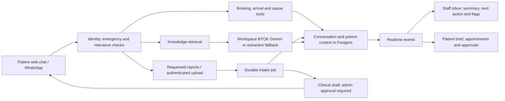

# Patient chat and staff workflow

## Decisions and accuracy

- Emergencies and medical-advice requests are checked before any booking or model call.
- Booking and queue status are database-backed tools; healthcare action results use their verified templates rather than model rewrites.
- Report collection asks only for clinic-requested documents. A visitor must have their own linked appointment before attaching a report in chat.
- A phone number typed by a web visitor never grants access to an existing patient's record.
- Scanned documents without readable text are flagged for manual intake. Report extraction is a review aid; clinical interpretation and outgoing clinical drafts require an admin/doctor's review.
- Clear spam/off-topic requests and duplicate messages are retained and flagged for staff review. Medical questions are not dismissed as spam.
- Incoming bursts are combined for 350 ms and processed sequentially per conversation on the current single-process web service. Identical substantive questions within 10 seconds are retained and flagged without generating another reply; numbered booking choices are exempt. Messages persist in Postgres; the short reply scheduler itself is in memory. Before scaling web replicas, move reply scheduling to the durable queue with per-conversation locking.

## Patient ↔ staff links

The hospital demo listens for the widget's conversation event. Its staff link opens `/try?conversation=<id>`, which enters the read-only demo and opens that thread. Server workspace and visitor checks remain authoritative. Staff see the patient's appointment, report status, last assistant summary, next action and review flag, with links to the patient brief and queue. The patient brief links back to the conversation. Report and visit events refresh the linked screens.

## Gemini BYOK

In the hospital owner's **Settings → Model & BYOK**, select **Google Gemini**, save the API key privately, and run **Test connection**. The key is encrypted and never included in public widget configuration or staff summaries. Missing keys and exhausted budgets use an explicitly labelled extractive fallback. A saved key is not evidence of a successful provider connection: use the connection test.

Questions and conversational action routing redact PII before model calls. Model answers must provide valid knowledge-source citations; malformed or uncited answers hand off to staff. Report-model extraction remains opt-in and does not send report text to a provider unless the clinic enables it.

## Verification

The end-to-end suite covers booking-to-report upload, exact patient context in the inbox, another visitor's upload rejection, same-phone identity isolation, burst consolidation, off-topic flags, missing-key fallback, and Gemini-compatible request routing with a local mock endpoint. That mock verifies request handling and redaction; it does not verify a real Google key. Live testing uses fictional patients and documents only.
