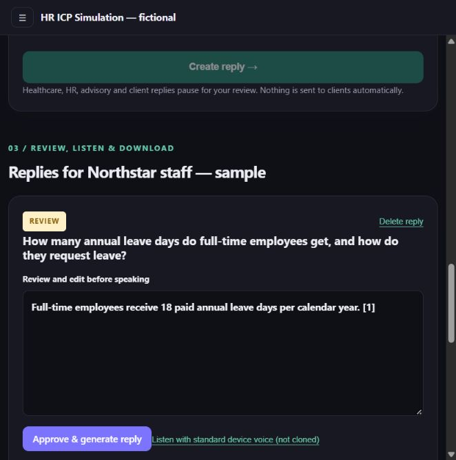
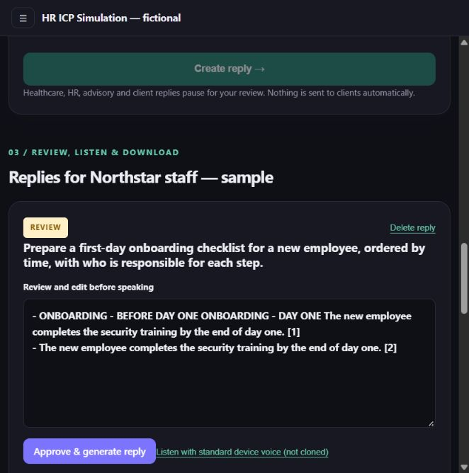
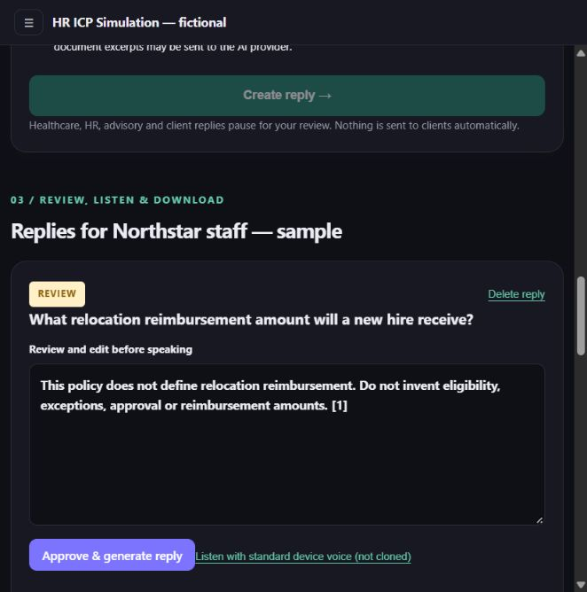
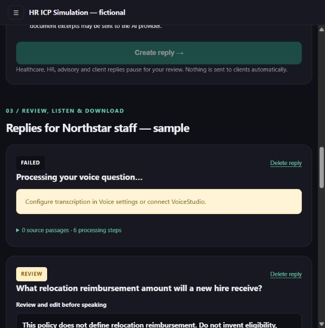
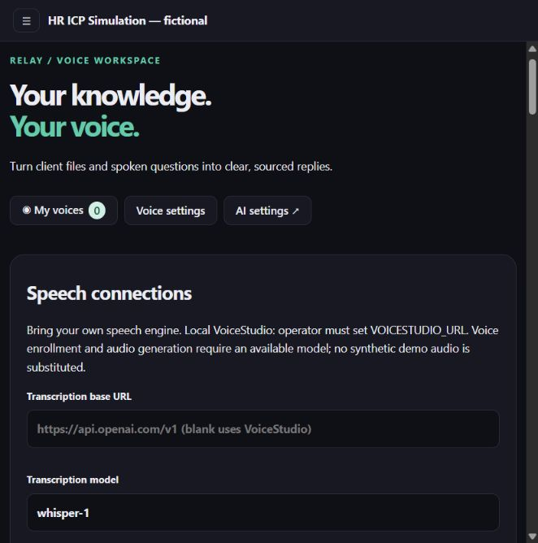
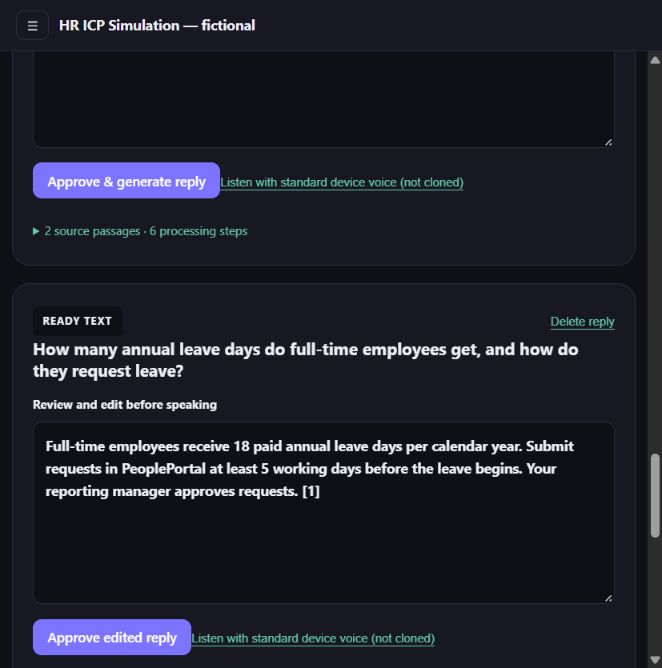

# HR ICP simulation — observed product results

**Decision: not ready for a self-service, voice-first customer pilot.** A simulated HR walkthrough found incomplete policy answers and an unusable onboarding checklist in the current extractive configuration. Review, editing and approval worked. Voice input was blocked by missing transcription; cloning and downloads were unavailable.

This is an agent-run usability and task rehearsal, **not an interview with an HR professional**. No real participant supplied feedback. It provides no evidence of demand, time savings, retention, willingness to pay, or product-market fit. Do not present it as customer validation.

## Test setup

- Date: 1 November 2026. App: `http://localhost:8788/app`.
- Repository branch: `voice-desk`; inspected commit: `b52f5c4`. The running container's `voice-desk.ts` SHA-256 matched the checkout at the start of the test.
- A separate workspace, **HR ICP Simulation — fictional**, and employee context, **Northstar staff — sample**, were created through the UI. The tester identity is explicitly synthetic.
- Uploaded `sample-handbook.txt` through the UI; it indexed into two passages. It contains fictional annual leave, onboarding, remote work and expense policies. No real employee records were used.
- Actual configuration: default reasoning provider, platform default **Extractive (no LLM)**; transcription unavailable; cloning provider `none`; no enrolled voices; no saved speech keys. No provider settings were changed and no API keys were entered.
- Existing viewport used for the visible browser test. This session did not test a physical phone, microphone capture or external HTTPS access.

## Observed task results

| Task | Acceptance criteria | Actual result | Verdict |
| --- | --- | --- | --- |
| Sign up, create employee context, upload handbook | Separate workspace and readable, indexed sample document | Completed through the UI; two passages indexed | Pass |
| Answer a two-part annual-leave question | State 18 days, PeoplePortal, five working days' notice and manager approval | Returned only “Full-time employees receive 18 paid annual leave days per calendar year. [1]” | Partial: omitted the request procedure, although it was in the retrieved source |
| Prepare a first-day checklist | Include 9:30 HR orientation, 10:30 IT setup, 2:00 manager briefing and end-of-day security training, with owners and ordering | Returned two bullets repeating security training, with duplicated headings; omitted all three timed steps | Fail |
| Answer an unspecified relocation allowance question | Explicitly say the allowance is not defined; invent no amount | Said the policy does not define relocation reimbursement; also quoted the internal instruction “Do not invent…” | Pass on missing-information safety; wording needs editing |
| Review, edit and approve HR content | Pause for review, retain human edits, finish without sending externally | All three text drafts paused at `review`. The leave answer was manually corrected; approval preserved it at `ready_text` | Pass for the tested text workflow |
| Process uploaded audio | Reach transcription and produce a transcript | A labeled one-second synthetic-silence WAV failed with “Configure transcription in Voice settings or connect VoiceStudio.” | Blocked by configuration; speech-recognition accuracy was not tested |
| Generate a cloned reply and download it | Enrolled voice, generated audio, working playback and download | No engine or voices; zero generated-audio players and zero audio download links | Not testable in this configuration |
| Listen with standard device voice | Audible, intelligible playback | Clicked the device-voice control; no visible status change. Audio cannot be verified from this test environment | Invoked, audibility unverified; do not count as a pass |

The human correction used in the approval test was:

> Full-time employees receive 18 paid annual leave days per calendar year. Submit requests in PeoplePortal at least 5 working days before the leave begins. Your reporting manager approves requests. [1]

That correction was entered by the test operator. **It was not generated by the app.**

## Visual evidence

These are screenshots of the actual running app, not mockups. The initial answer snapshot is preserved in `observations-before-approval.json`; `observations.json` holds the final observed state. Both contain only this synthetic workspace's test data.

### 1. Initial policy answer: correct quota, missing procedure

### 2. Checklist: duplicated training item, missing timed steps

### 3. Missing policy: no invented relocation amount

### 4. Audio attempt: transcription is not configured

### 5. Speech configuration: cloning is not connected

### 6. Human-edited answer retained after approval

## ICP hypothesis to test with real people

The proposed first cohort is an **HR generalist or people-operations coordinator handling repeated onboarding and policy questions**, with an HR lead as the possible budget owner. This is a recruiting hypothesis, not an established ICP. Qualify using recent tasks, question frequency, document-search effort and purchase authority; do not assume company size or payment capacity proves fit.

The job to test is: **“Help me produce a complete, policy-grounded employee reply quickly, while keeping approval with me.”** Test that before assuming the employee wants a voice reply or that HR wants a clone of their own voice. Neither voice preference nor willingness to pay was measured here.

## Findings to resolve before a real pilot

1. **Answer completeness:** two of the three content tasks missed their completeness criteria. Connect a reasoning model and rerun the same source-backed tasks. Do not assume connecting a model automatically fixes retrieval, omissions or unsupported claims.
2. **Voice readiness:** connect transcription and a cloning engine; enroll an actual volunteer's own authorized voice; test consent, revocation, playback and a downloaded file on a physical phone over HTTPS. The silence fixture tests only the missing-configuration path.
3. **Onboarding friction to investigate:** HR must map employees/policies onto labels such as “client workspace.” Whether that wording causes confusion is a hypothesis for real participants, not an observed participant complaint.
4. **Communicate fallback mode:** the current page promises an agentic voice workflow while the tested setup supplies extracts and no voice. A participant must know which capabilities are actually active before evaluating the product.
5. **Keep pilot data synthetic:** this session did not audit privacy export/erasure, data retention, regulatory suitability or shared-deployment security. It did not merge another branch, deploy publicly or fix application code.

## Next live test and decision rule

Use `FACILITATOR.md` and the blank `participant-scorecard.csv` with five qualified HR professionals. These are proposed pilot gates, not statistical proof of PMF:

- At least four complete the core policy-answer task without coaching.
- All policy quantities, dates and exceptions used in a reply are supported by the source; zero invented allowances or approvals.
- Measure each person's usual workflow first, then the app workflow on comparable tasks; require a meaningful reduction in total time **including review and edits**. A 30% reduction is a proposed threshold to agree before testing, not a result of this simulation.
- Assess typed answers, standard voice and authorized cloned voice separately. Keep content constant when comparing voice modes.
- Record actual second-session commitments, a named budget owner and concrete paid-pilot interest. Leave willingness-to-pay fields blank unless a real person supplies them.

Until those tests are run, the evidence supports only this conclusion: the review workflow is usable by the test operator, and the unconnected extractive/voice setup is not ready to represent the finished product to customers.
