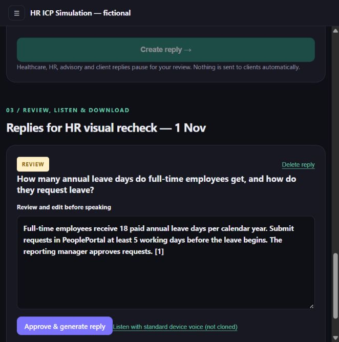
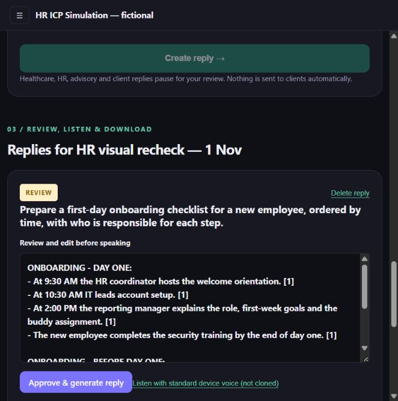
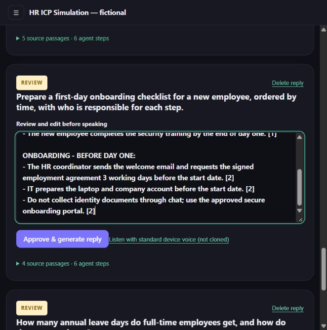
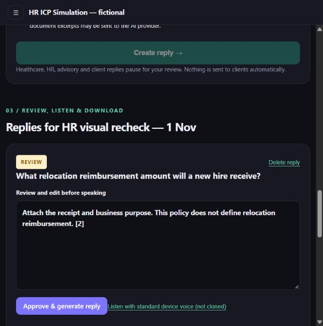
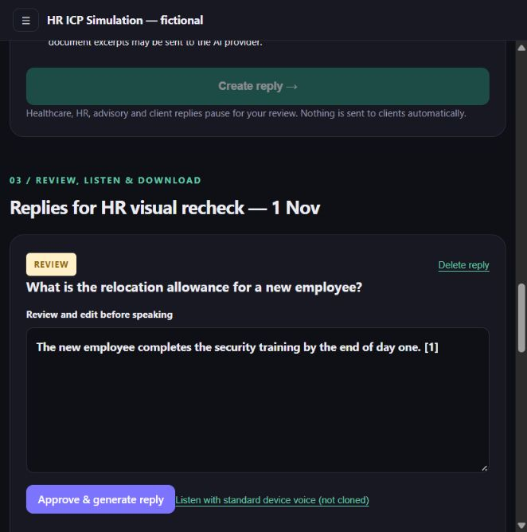
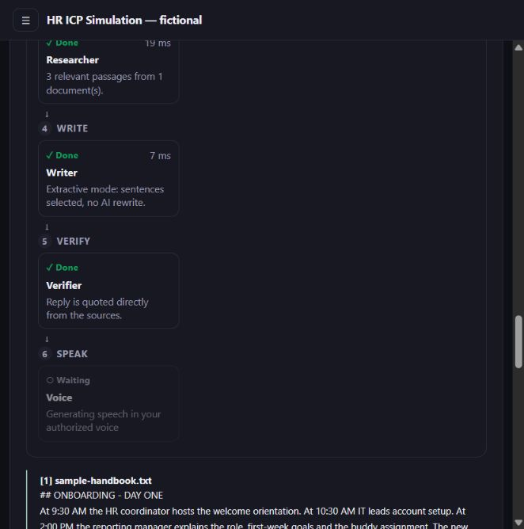
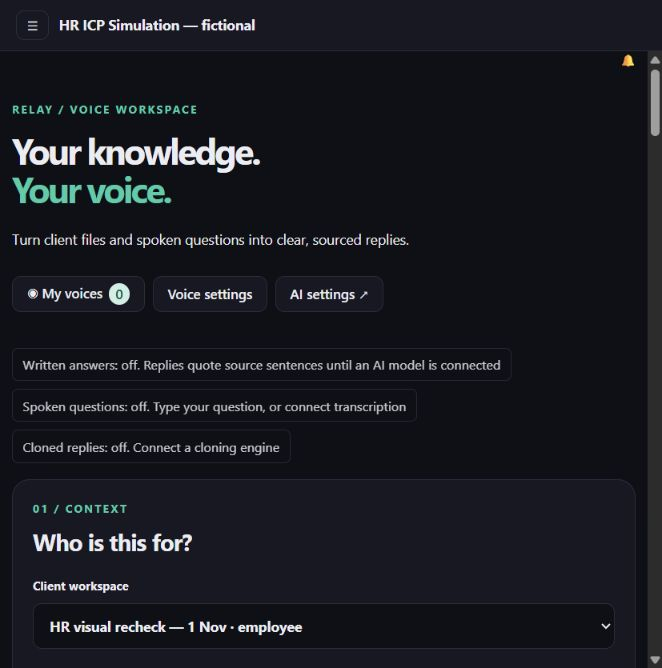

# HR visual ICP rehearsal — independent recheck

**Result: not ready for a voice-first customer pilot. Answer relevance is also an unresolved text-workflow blocker.** Leave improved and passes. The first-day checklist is complete for its day-one steps but includes out-of-scope prework. A natural rewording of the relocation question returns an unrelated answer with a citation and a successful source-verification status.

This was an agent-operated visual walkthrough on **1 November 2026**, approximately **1:14–1:19 PM IST**, using fictional data. No real HR professional participated. No customer preference, time savings, payment interest or PMF was measured.

## What was checked

- Running app: `http://localhost:8788/app`; health endpoint reported PostgreSQL and `ok: true`.
- Checkout: branch `voice-desk`, commit `8f1234a`; clean at the start of this check. The running container's `engine/extractive.ts` SHA-256 matched the checkout. This supersedes the earlier message's claim that the fixes were still uncommitted; it records the state observed now.
- Reused the existing **HR ICP Simulation — fictional** workspace and existing synthetic account. Created only a new employee context, **HR visual recheck — 1 Nov**: no additional signup or workspace.
- Uploaded the original `sample-handbook.txt` afresh through the UI. It produced **seven indexed passages**, rather than the earlier upload's two. Earlier documents and results were retained.
- Confirmed no reasoning model, no transcription, cloning provider `none`, and no enrolled voices. No keys or provider settings were changed.
- Ran the four questions below through the visible UI. Approved only the correct leave response, without editing it. The other three drafts remain in review for inspection.
- Independently ran `pnpm test`: **71 discovered, 70 passed, 1 skipped, 0 failed**. The skipped test was cross-instance PostgreSQL notifications because `TEST_DATABASE_URL` was not set. This test result does not override the visible task failures below.

## Results

| Case | Required result | Observed result | Judgment |
| --- | --- | --- | --- |
| Annual leave: original two-part question | 18 days; PeoplePortal; five working days' notice; manager approval | All four facts returned with citation. Approval retained the generated answer and completed at `ready_text` | **Pass** for this document and wording |
| First-day onboarding checklist | Four day-one steps, chronological times and owners; no before-day-one work | Correct 9:30 HR, 10:30 IT, 2:00 manager and day-end employee training. Also appended three before-day-one items **after** day-one work | **Partial**: day-one completeness passes; scope and overall order fail |
| Exact relocation question | Explain that reimbursement is undefined; no unrelated instructions | “Attach the receipt and business purpose. This policy does not define relocation reimbursement. [2]” | **Partial**: safe missing-policy statement, irrelevant receipt instruction |
| Reworded relocation question | Same undefined-policy answer | “The new employee completes the security training by the end of day one. [1]” | **Fail**: unrelated answer; citation does not make it relevant |
| HR review gate | Unapproved drafts stay in review | All four initially paused for review; only the leave answer was approved | **Pass** for the observed workflow |
| Readiness information | Clearly state inactive features | Written answers off/extractive; spoken questions off; cloned replies off | **Pass** |
| Speech inputs without transcription | Prevent starting unusable audio work | Microphone and audio upload were both disabled | **Pass** for configuration gating; actual voice remains untested |
| Cloned playback, downloads and phone use | Connected engine, enrolled voice, usable audio on a physical phone | Zero generated-audio players and zero audio download links; no engine or voice | **Not testable** in this configuration |

## Exact prompts and outputs

### 1. Leave

Prompt:

> How many annual leave days do full-time employees get, and how do they request leave?

Generated answer, before approval and without operator editing:

> Full-time employees receive 18 paid annual leave days per calendar year. Submit requests in PeoplePortal at least 5 working days before the leave begins. The reporting manager approves requests. [1]



### 2. Checklist

Prompt:

> Prepare a first-day onboarding checklist for a new employee, ordered by time, with who is responsible for each step.

The day-one section contains all four expected steps without duplicates. However, the answer then appends:

```text
ONBOARDING - BEFORE DAY ONE:
- The HR coordinator sends the welcome email and requests the signed employment agreement 3 working days before the start date. [2]
- IT prepares the laptop and company account before the start date. [2]
- Do not collect identity documents through chat; use the approved secure onboarding portal. [2]
```

Under a strict **first-day-only** acceptance criterion this remains partial, rather than a complete pass. These are real policy sentences but outside the requested time scope; pre-start steps also appear after day-one steps.





### 3. Exact relocation wording

Prompt:

> What relocation reimbursement amount will a new hire receive?

Answer:

> Attach the receipt and business purpose. This policy does not define relocation reimbursement. [2]

The “Do not invent…” quotation is gone. The unrelated receipt sentence remains. No reimbursement amount was invented, but this is not yet a clean employee-ready answer.



### 4. Natural rewording

Prompt:

> What is the relocation allowance for a new employee?

Answer:

> The new employee completes the security training by the end of day one. [1]



Opening the agent trace showed **Verifier: Done — “Reply is quoted directly from the sources.”** The correct missing-relocation-policy sentence was present in retrieved source passage [3], but the answer selected a training sentence from passage [1]. This demonstrates a relevance/selection failure even with the relevant policy statement available. Source-quotation verification is not the same as answer relevance.



## Readiness and browser observations

The current app accurately displays:

```text
Written answers: off. Replies quote source sentences until an AI model is connected
Spoken questions: off. Type your question, or connect transcription
Cloned replies: off. Connect a cloning engine
```

Both microphone and audio upload controls were checked and were disabled. No microphone permission was granted, no real voice was captured, and no synthetic sample was represented as an enrolled person. Standard device-voice audibility was not retested in this check.



The already-open browser initially retained an older application bundle and interface after an ordinary reload. A hard refresh (`Ctrl+Shift+R`) loaded the current readiness indicators and disabled inputs. The browser initially referenced `index-heNWmvUH.js`, while the server served `index-CwgfwY4_.js`. This is an observed stale-page/app-shell issue, not a complete service-worker root-cause diagnosis. For pilot sessions, verify the readiness indicators after an update rather than assuming an old open tab has updated.

## Pilot decision

Do not report this as an HR ICP validation or a successful voice trial. The specific leave improvement is confirmed; the exact relocation prompt and checklist are partial under stricter usefulness criteria; the natural rewording fails.

Before a real pilot:

1. Require an unsupported or off-topic match to abstain rather than return a confidently cited unrelated sentence. Add the reworded prompt as a regression scenario, and check answer relevance as well as source support.
2. Require first-day checklists to exclude pre-start work unless requested. Remove unrelated sentences from missing-policy answers.
3. Connect and test the actual reasoning and speech configuration; rerun both original and paraphrased prompts. Do not assume a connected model automatically resolves these issues.
4. Verify authorized voice enrollment, cloned playback, download, consent revocation and physical-phone use over HTTPS.
5. Then conduct the real sessions in `FACILITATOR.md`, measuring task time including edits, actual repeat use, voice preference and budget ownership.

Evidence is still limited to one short fictional handbook. No new application fixes, branch merges, commits, provider purchases or public deployments were performed in this check. `REPORT.md` and `RERUN.md` were left unchanged. The exact scoped run data and agent traces are in `VISUAL_RECHECK.json`.
